# QA_STUDENT: the student and market lenses, with evidence

This file is the proof pack of the student lane (STUDENT-16). It answers two council findings that code alone can answer
only in part:
- the student judge tested in Playwright emulation only, and "Stage C, unit review, chest opening, the placement result
  screen and Exam Rescue were not completed end to end";
- the market judge: "no users".

The first is answered below with one command, a week of one student's life and a picture for each day. The second needs
real people. The code side is ready, and the owner's part is listed as single actions:
- the real-device check: [section 4](#4-real-devices-owner-only-about-20-minutes);
- the five-student test: [docs/student-test.md](docs/student-test.md);
- the store and server steps: [section 6](#6-owner-steps-one-action-each).

Contents:
1. [One command](#1-one-command)
2. [A week in a student's life](#2-a-week-in-a-students-life)
3. [Council findings, item, test, picture](#3-council-findings-item-test-picture)
4. [Real devices (owner only)](#4-real-devices-owner-only-about-20-minutes)
5. [Before and after: the council's seven screenshots](#5-before-and-after-the-councils-seven-screenshots)
6. [Owner steps](#6-owner-steps-one-action-each)
7. [Deferred: what is not on this branch, and why](#7-deferred-what-is-not-on-this-branch-and-why)
8. [What the week showed that is still open](#8-what-the-week-showed-that-is-still-open)

---

## 1. One command

```
cd madregot/web
npm run test:week          # E2E_PORT=4231 npm run test:week when another copy uses port 4173
```

This runs `e2e/student-week.spec.js` (tag `@student`) on three Playwright projects:
- `phone` (390x844);
- `phone-small` (320x568);
- `phone-dark` (390x844 with the phone in dark mode).

It builds the app with no server of its own, as the public site runs. It takes about 3 minutes on a shared 4-CPU
machine. The pictures it writes:

| Folder | What |
|---|---|
| `qa-evidence/student/week/<project>/` | one picture per day (two or three on Thursday and Sunday) |
| `qa-evidence/student/extra/<project>/` | the placement result, the unit review, Exam Rescue's plan and its first task |
| `qa-evidence/student/after/` | the council's seven screens, taken again (section 5) |
| `qa-evidence/student/before/` | the council's own screenshots, copied from its run |

**What every test checks.** Each test fails on any console error or page error, and every picture first checks that the
page does not scroll sideways. During the week the test also checks that every request the app makes is one it expects.

**What it runs against.** The server is a fake (`page.route`), with one exception. The reminder's key and the
subscription go to the Worker's own handlers, which run in memory on an in-memory D1 (`worker/test/helpers.js`), so the
subscription the app sends is one the Worker accepts. Friday and Shabbat run the Worker's real `pushDue` cron function
on that row. Everything is synthetic: example.test addresses, a made-up class, and a played push service. Nothing leaves
the machine.

**The browser.** The file runs on the full Chromium (`channel: 'chromium'`), because Chromium's headless shell has no
notifications, so the reminder could never be offered there.

**One browser per day.** Each day opens the app in a fresh browser context. It carries what the phone saved the day
before: localStorage and IndexedDB. A context kept all week let the test clock's `performance.now()` run ahead of the
page's animation timeline, so the app's exit animations waited seconds to start.

---

## 2. A week in a student's life

The test clock (`page.clock`) moves from **Sunday 8 November 2026** to **Sunday 15 November 2026**. The student is the
same all week: נועה, grade ז׳, on one phone. Everything is done through the app's own buttons. The class is ז׳3 (code
K7Q2MD), and the class goal is 60 steps.

| Day | What she does | What the test asserts | Picture (phone) |
|---|---|---|---|
| **Sun 8.11**, 16:00 | First questions (name, grade, "קצת מוכר", 10 minutes a day, no class code yet, "מתחילים מההתחלה"). She goes to stage A of חיבור וחיסור, then from the map to the stair's page and "מתרגלים לבד": a first lesson | Stage A's moment says "+10 XP" and "התחלתם רצף". The header streak is 1. After the lesson comes the daily goal's own moment ("הגעתם ליעד היומי!", 25 XP). The day is saved with 1 stage and 1 lesson | [1-sunday-goal](qa-evidence/student/week/phone/1-sunday-goal.png) |
| **Mon 9.11**, 16:00 | Joins her class from אני › הגדרות with the teacher's code and her own 4-digit code. Then the next step the stair page offers, the worked examples (stage B). Then the missions tab | Joining turns sounds off, because she never chose (STUDENT-7). The worked example sends its step to the server before the goal is asked. The card above today's missions says "15 מתוך 60 צעדים" and "החלק שלכם השבוע: צעד אחד". No classmate's name, no rank, no "ליגה" | [2-monday-class-goal](qa-evidence/student/week/phone/2-monday-class-goal.png) |
| **Tue 10.11**, 20:30 | Does not learn. Opens the app in the evening and closes it | Streak 2. No repair card, because yesterday she learned. No word of pressure (`פספסתם, תפספסו, איבדתם, נשבר, נגמר הרצף, תאבדו, יימחק, מהרו` are all absent). Nothing is saved for Tuesday | [3-tuesday-home](qa-evidence/student/week/phone/3-tuesday-home.png) |
| **Wed 11.11**, 16:00 | The repair card. Two practice lessons. After the first, the reminder offer (her third learning day): "להפעיל" at 17:00 | The card says "אתמול לא יצא ללמוד. עוד שני שיעורים היום, והרצף של 2 ימים נשמר." The offer has no ₪, plan or streak threat, and 17:00 is chosen. The Worker accepts the subscription (200), with the endpoint, keys and slot "17" exactly as the app sent them. After the second lesson: "3 ימים ברצף!", "הרצף נשמר. 3 ימים ברצף.", and Tuesday is shown as "הרצף נשמר" in the week strip. The offer does not come again. Two lessons without a mistake finish the day's three missions, which gives one streak freeze | [4-wednesday-streak-kept](qa-evidence/student/week/phone/4-wednesday-streak-kept.png) |
| **Thu 12.11**, 16:00 | From the map: זוויות, stair 1, "כל חמשת השלבים", "בדיקת שליטה". Then stairs 2 and 3 | All three checks give "שולטים לבד!". The third says "פתחתם תיבת אוצר". Then comes the unlock moment ("מדי קיבל משהו חדש", "שלטתם בחצי הראשון של זוויות, ומדי קיבל כתר מד־זווית.") and she taps "לשמור על מדי". The chest on the path says "פתחתם: כתר מד־זווית.". In the wardrobe the crown is chosen and the class scarf is locked. The day has mp = 3 | [5-thursday-unlock](qa-evidence/student/week/phone/5-thursday-unlock.png), [5b chest](qa-evidence/student/week/phone/5b-thursday-chest.png), [5c wardrobe](qa-evidence/student/week/phone/5c-thursday-wardrobe.png) |
| **Fri 13.11** | Does not learn. In the morning she looks at the reminder in Settings | Settings shows the reminder on at 17:00, with the rule ("לא נשלחת בשבת ובחגים… לא אחרי 12:00 בערב שלהם"). The app had told the server that she learned on Thursday. Then the Worker's `pushDue` runs on her row: at 16:37 to 20:37 it returns `skipped: 'quiet'` (Shabbat eve), and at 11:37 `skipped: 'hour'`. **Nothing is sent** | [6-friday-reminder](qa-evidence/student/week/phone/6-friday-reminder.png) |
| **Shabbat 14.11**, 11:00 | Opens the app, then the missions tab | On opening, Wednesday's freeze covers Friday (`frozen: true`, freezes 0). Shabbat is a rest day, and the streak is still **4**. "בשבת ובחג הרצף נשמר." The class has not reached its goal yet, so there is no moment. `pushDue` at 16:37 to 20:37 returns `quiet`, and nothing is sent. Control: the same row on Monday 16.11 at 17:37 is sent once, to her address, so the silence is the rule and not a dead row | [7-shabbat-streak](qa-evidence/student/week/phone/7-shabbat-streak.png) |
| **Sun 15.11** (recap) | The recap card, its sheet and "לשלוח להורים" | **Skipped, with the reason** in the test: STUDENT-6 is not on this branch (section 7) | none |
| **Sun 15.11**, 10:00 | Opens the app | Last week's goal was reached (50 steps from the class plus her **12**). The moment "עשינו את זה יחד" says "הכיתה שלכם עברה את המטרה של השבוע שעבר, ואתם הוספתם 12 צעדים. מדי קיבל צעיף כיתה." The 12 is what the server counted from the steps her phone sent: 1 on Monday, 2 on Wednesday and 3×3 on Thursday. "לראות את מדי" opens the wardrobe with the class scarf on, next to the crown. After a reload the moment does not come again | [8-sunday-class-goal](qa-evidence/student/week/phone/8-sunday-class-goal.png), [8b wardrobe](qa-evidence/student/week/phone/8b-sunday-wardrobe.png) |

The same days at 320x568 are in `qa-evidence/student/week/phone-small/`, and in dark mode in `.../week/phone-dark/`.

**Also captured** (`qa-evidence/student/extra/<project>/`), as the council's "not completed end to end" list asks:

| Screen | How it gets there | Picture (phone) |
|---|---|---|
| The placement result | First questions with "בדיקת רמה קצרה", then every question answered (right up to level 2): "מצאנו את המדרגה שלכם" with a row per tested topic | [placement-result](qa-evidence/student/extra/phone/placement-result.png) |
| The unit review | A student who mastered all five stairs of מערכת צירים opens "חזרה על היחידה", "התחלה", and plays it to "סיימתם חזרה על היחידה!" with "מערכת צירים: היחידה הושלמה" | [unit-review-done](qa-evidence/student/extra/phone/unit-review-done.png) |
| A chest opening on the path | In the week, Thursday | [5b chest](qa-evidence/student/week/phone/5b-thursday-chest.png) |
| Exam Rescue to its first task | The exam's date, the topic, the short check, the plan, then today's first task with "מתחילים" | [rescue-plan](qa-evidence/student/extra/phone/rescue-plan.png), [rescue-first-task](qa-evidence/student/extra/phone/rescue-first-task.png) |
| Stage C (solve together) and stage E (mastery check) | Stage E is in the week (Thursday). Stage C runs end to end in `learn.spec.js`, "a new stair is learned before it is practised: understand, a worked example, solve together" | none |

A note on the pictures: "זמן 0:00" on the placement and review results is the test clock, which stands still within a
test. A student sees the minutes they took.

---

## 3. Council findings, item, test, picture

The council's run is `council1.json`. Its screenshots are in the scratchpad's `council/student/`. Items are from the lane
spec (`STUDENT-n`). "integrity" means the merged integrity build that this lane started from (`5618298`).

### Student lens (5.5)

| Finding (council) | Item | Tests | Picture |
|---|---|---|---|
| Critical #21: the first session has no payoff | integrity (StageDone: XP and streak for a teaching stage), STUDENT-7 (the daily goal's moment) | `flows.spec.js` "the first session gives something back"; "the daily goal has its own moment"; the week, Sunday | week/phone/1-sunday-goal |
| Major #22: teaching screens are mostly text | STUDENT-8 (a drawing or object on every teaching step, all topics) | `teach-all.spec.js` (every step at 320x568); `figures.test`, `visuals.test` | after/i13f-02-teach-0, after/t6-01-predict-wrong |
| Major #23: progress feels like zero | integrity (counters that move), STUDENT-5 (learning days, a weekly best) | `flows.spec.js` (the unit and stair counters); `streak.spec.js` (the weekly best, learning days); the week, Shabbat | after/L2-09-end-16, week/phone/7-shabbat-streak |
| Major #24: the path is identical across units | STUDENT-1 (colour, emblem and drawings per unit) | `identity.spec.js`; `tokens.test.js` | after/h1-02-home-full |
| Major #25: no teen motivators (no avatar, no league, chests give only freezes, no dark mode) | STUDENT-2 (dark mode), STUDENT-3 (Madi's wardrobe, chests that say what they hold), STUDENT-4 (a cooperative class goal instead of a league), STUDENT-5 (a weekly personal best for solo students) | `dark.spec.js`, `wardrobe.spec.js`, `class-goal.spec.js`, `streak.spec.js`; the week, Monday, Thursday and Sunday | after/dark-home, after/T13-06-__me-full, week/phone/2, 5, 5c, 8, 8b |
| Adult and developer copy on student screens | integrity (`/settings/advanced`), STUDENT-9 §6 (Me in the student's words) | `flows.spec.js` "settings: a student sees no server address or key"; `learn.spec.js` "the profile shows what the evidence says" | after/T13-06-__me-full |
| The number line's controls hide under the "not yet" sheet | STUDENT-9 §2 | `manip.spec.js` "the number line's buttons stay above the 'not yet' sheet" (3 sizes) | after/t3-02-wrong1 |
| Hebrew and typography: plural after the name, KaTeX digits, a disabled "הקודם" | STUDENT-9 §3-§5 | `teach-all.spec.js` "digits inside inline maths are Rubik"; "the first teaching step has no 'previous' button"; `flows.spec.js` (no pronoun after the name) | after/i13f-02-teach-0 |
| Touch targets under 44px; the daily goal only a chip | STUDENT-9 §1, STUDENT-7 | `targets.spec.js` (Learn, Topics, Quests, Me, a lesson, a teaching step); `flows.spec.js` daily goal | week/phone/1-sunday-goal |
| Sound on by default in class | STUDENT-7 | `flows.spec.js` "sound and vibration are two choices"; the week, Monday (sounds off on joining) | none |
| The first load is heavy | STUDENT-15 (budget gate, lazy lesson) | `scripts/check-budget.test.mjs`; `npm run build` fails over budget | none |
| Not tested: real iPhone (safe area, keyboard, finger drag, haptics, sound) | OWNER-ONLY | [section 4](#4-real-devices-owner-only-about-20-minutes) | owner's table |
| Not completed end to end: stage C, stage E, unit review, chest, placement result, Exam Rescue | STUDENT-16 | this file, section 2 | week/, extra/ |
| Strength #26: the wrong-answer diagnosis | kept | the week (every lesson); `learn.spec.js` | after/t3-02-wrong1, after/t6-01-predict-wrong |
| Strength #27: tactile objects | kept, and the stepper is now visible | `manip.spec.js` | after/t3-02-wrong1 |
| Strength #28: the lesson-end sequence, with Shabbat as a safe day | kept and extended to Yom Tov, with a repair (STUDENT-5) | `streak.spec.js`; the week, Wednesday and Shabbat | week/phone/4, 7 |

### Market lens (3.5)

| Finding (council) | Item | Tests | Evidence |
|---|---|---|---|
| Critical #64: no distribution: not installable, no push, in no store, no users | STUDENT-10 (install offer, richer manifest), STUDENT-11 (opt-in reminder), STUDENT-12 (store mode, Play wrapper, listing, pictures), STUDENT-13 (landing pages), STUDENT-14 (reach counts) | `install.spec.js`, `manifest.spec.js`, `offline.spec.js`, `push.spec.js`, `store-mode.spec.js`, `store-ios.spec.js`, `landing.spec.js`; `listing.test.mjs`, `store-android.test.mjs`, `landing-build.test.mjs`; worker `push.test.js`, `webpush.test.js`, `metrics.test.js`, `assetlinks.test.js`; the week, Wednesday to Shabbat | `qa-evidence/student/install/`, `push/`, `landing/`, `store/`, `reach.txt`; `store/apple/`, `store/play/` |
| "No users" | OWNER-ONLY: the five-student test ([docs/student-test.md](docs/student-test.md)), the store submissions (section 6) and the pilot (teacher lane, TEACHER-13). `npm run owner -- reach` counts what happens without tracking anyone | worker `owner-script.test.js` (reach) | `qa-evidence/student/reach.txt` |
| Minor: no push notifications, so the habit loop is missing | STUDENT-11 | as above; the week, Wednesday, Friday and Shabbat | week/phone/6-friday-reminder |
| Minor: the game layer copies Duolingo; the social part is missing | STUDENT-4 (a class goal, cooperative and without ranks) | `class-goal.spec.js`; the week | week/phone/2, 8 |
| Strength #72: the exam features match "a test on date X" | STUDENT-13 `/mivchan/` leads to Exam Rescue | `landing.spec.js`; the extra Exam Rescue test | extra/phone/rescue-plan |
| Critical #63 (curriculum), #65 (AI cost), #67 (parents see nothing), #68 (billing and legal) | other lanes: curriculum, AI, parents and trust | their own QA files | none |
| Major #66, #69, strengths #70 and #71 (rivals, what is a moat) | STUDENT-17 (added by coverage) | **not on this branch** (section 7) | none |

---

## 4. Real devices (OWNER-ONLY, about 20 minutes)

Code cannot prove how a real phone behaves. Run this once on a build with a server (after the deploy in section 6), on
four targets. Use your own phones or an adult tester's, never a student's. Record only what is asked: no names, no phone
numbers, no account details.

**Targets:**
- (A) iPhone, Safari in a tab;
- (B) the same iPhone, after "הוספה למסך הבית" (iOS 16.4 or later for the reminder);
- (C) an Android phone, Chrome;
- (D) the Play Store app (TWA), once it is on internal testing.

**How to check.** Start each target with a new student (מתחילים), answer the first questions, and do stage A and one
lesson. Then go through the rows. Mark each cell ✓, ✗ (and add a note) or n/a.

| # | Check | How | A | B | C | D | Notes |
|---|---|---|---|---|---|---|---|
| 1 | Sound on the first tap | Settings › צלילים: פועלים. Answer one exercise right. The sound plays on that first answer, not only from the second | | | | | |
| 2 | Vibration | Settings › רטט: פועל. A right and a wrong answer feel different, and finishing a lesson gives a longer buzz. iPhone has no web vibration, so the row says "בדפדפן הזה אין רטט." there: mark that as ✓ | | | | | |
| 3 | Reminder | On the third learning day, the card after a lesson: "להפעיל" for the next whole hour. It arrives within that hour, in Hebrew, right to left, and a tap opens the app. Not on Friday afternoon or Shabbat. On A, Settings says to add the app to the Home Screen first (that is ✓) | | | | | |
| 4 | Dark mode follows the phone | Set the phone to dark, then open the app. It opens dark with no white flash. Settings › מראה: בהיר stays light after closing and opening | | | | | |
| 5 | Notch and safe areas | Nothing sits under the notch, the Dynamic Island or the home bar: the top bar, the lesson's progress bar and close button, the keypad and "בדיקה", and the tab bar. Check portrait, and landscape once | | | | | |
| 6 | The number line by finger | In a number-line exercise, drag the marker. It follows the finger, the page does not scroll sideways, and −/+ stay visible above the "not yet" sheet | | | | | |
| 7 | The keyboard | Name field on the first screen and the class code in Settings. The keyboard does not hide the field or the button. Inside lessons the app's own keypad is used, and the phone's keyboard never opens | | | | | |
| 8 | Install | C: the install offer after a lesson on the second learning day opens Chrome's prompt, and the app opens from the home screen with its icon and name. B: the app opens full screen with its icon | | | | | |
| 9 | Offline | Turn on flight mode in the installed app (B, C or D). Open the map, a lesson and Settings. The offline chip shows, and the work is kept when the network is back | | | | | |
| 10 | Animations | Lottie confetti, the streak flame and Madi's moments play smoothly, and stop when the phone asks for reduced motion | | | | | |

Date of the check: ________ · Build (version.json): ________ · Who checked (role only, e.g. "owner"): ________

---

## 5. Before and after: the council's seven screenshots

On the left is the council's screenshot (`qa-evidence/student/before/`, 390 wide at 3x, taken at 390x664). On the right
is the same screen now (`qa-evidence/student/after/`, 390x844). The test takes the after pictures:
- home, profile and dark home: נועה's own after the week (the Shabbat test);
- the teaching steps and the lesson's end: the test "the council's screens, after".

| Council screenshot | Before | After | What changed, and which item |
|---|---|---|---|
| `h1-02-home-full` | 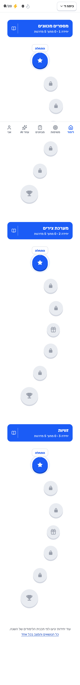 | 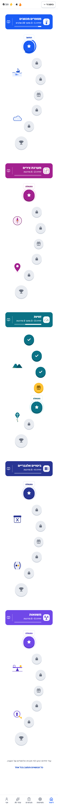 | Each unit has its own colour, emblem and two drawings beside the path (STUDENT-1). After the week the angles chest is gold and open, and its three stairs are done (STUDENT-3). The counters read in stages ("3 מתוך 25 שלבים"), not zero |
| `dark-home` | 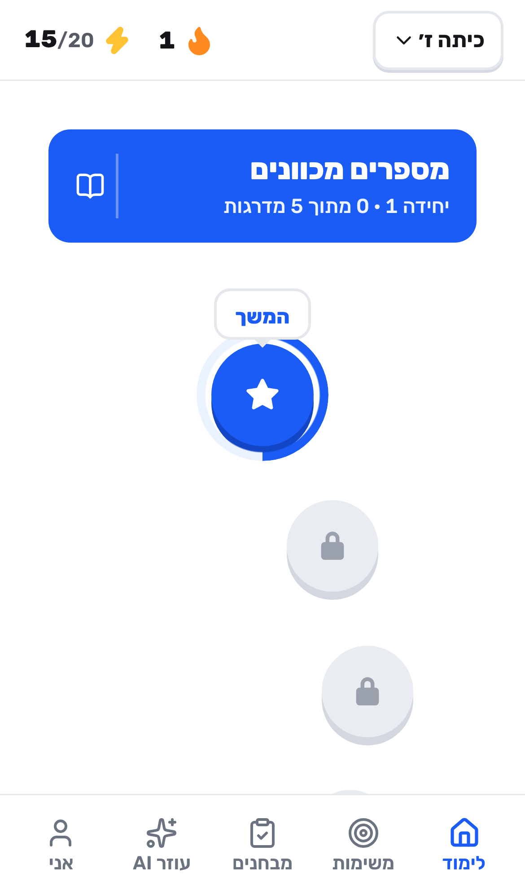 | 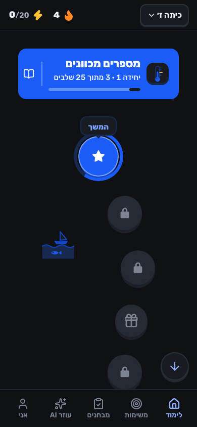 | The app follows the phone's dark setting, with AA text and 3:1 edges (STUDENT-2) |
| `T13-06-__me-full` | 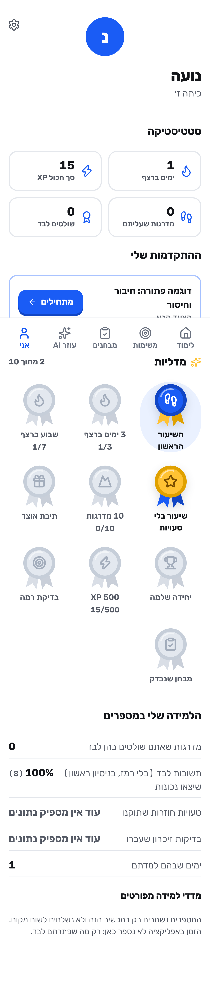 | 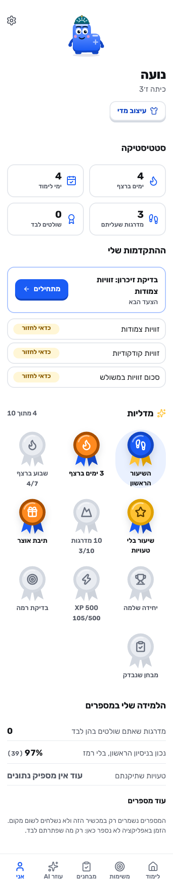 | Her Madi, wearing what she earned, replaces the letter, with "עיצוב מדי" under the name (STUDENT-3). "ימי לימוד" replaces total XP (STUDENT-5). The numbers are in the student's words (STUDENT-9 §6). See section 8 for "שולטים לבד 0" |
| `i13f-02-teach-0` | 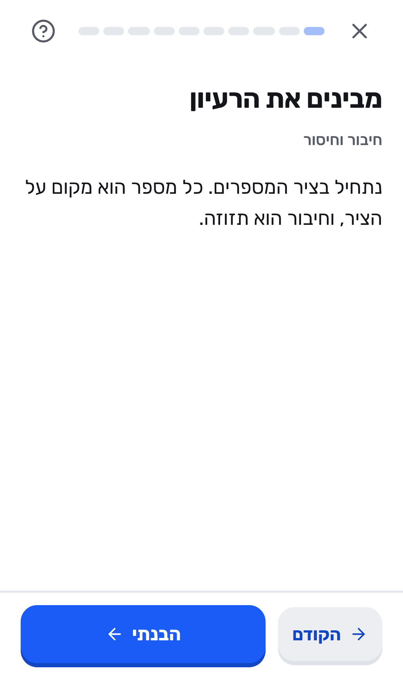 | 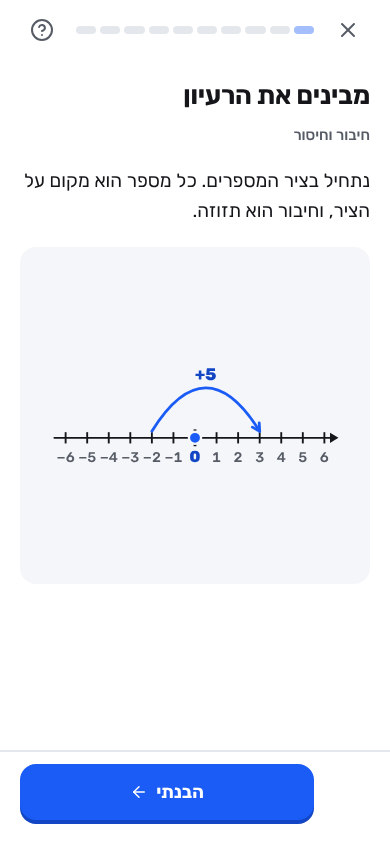 | The sentence now has its drawing: a number line where the +5 jump draws itself (STUDENT-8). The disabled "הקודם" is gone on the first step (STUDENT-9 §5) |
| `t3-02-wrong1` | 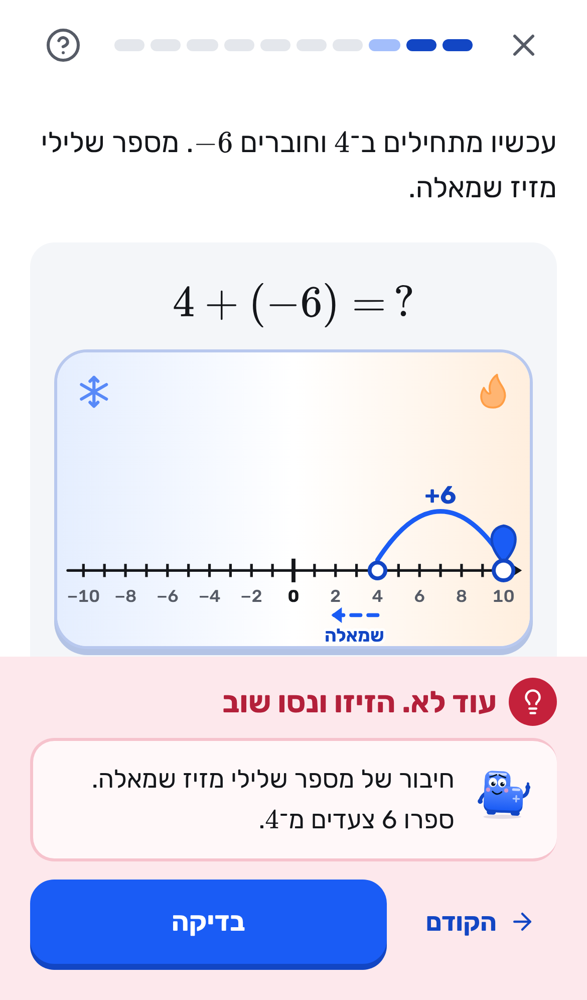 | 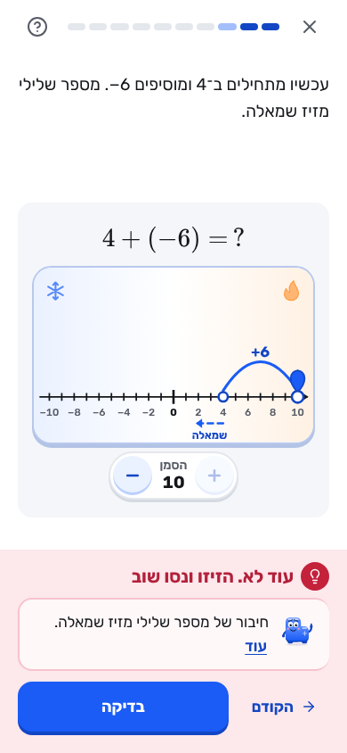 | The −/+ stepper and the marker's value stay visible above "עוד לא. הזיזו ונסו שוב" (STUDENT-9 §2). The diagnosis is kept |
| `t6-01-predict-wrong` | 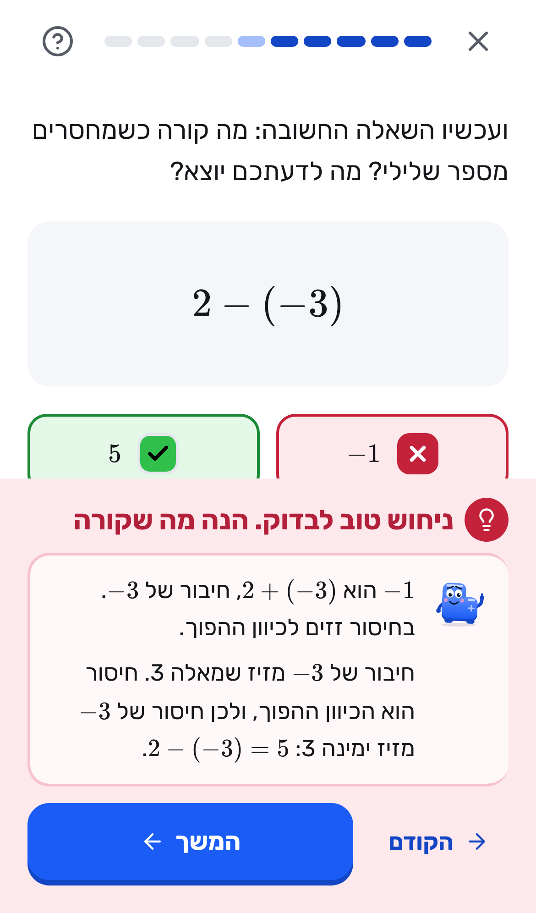 | 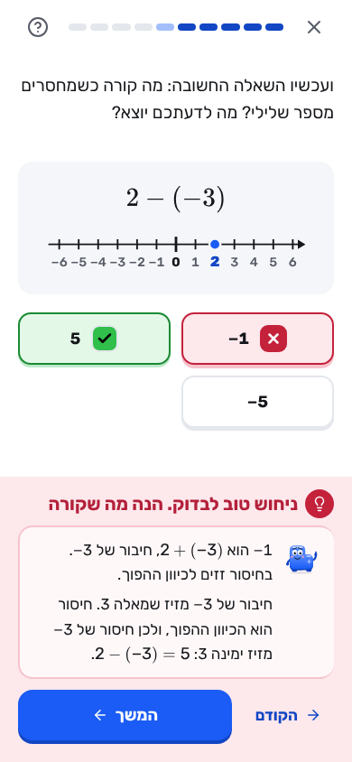 | The question has its number line, with 2 marked (STUDENT-8). The explanation of the guess is kept |
| `L2-09-end-16` | 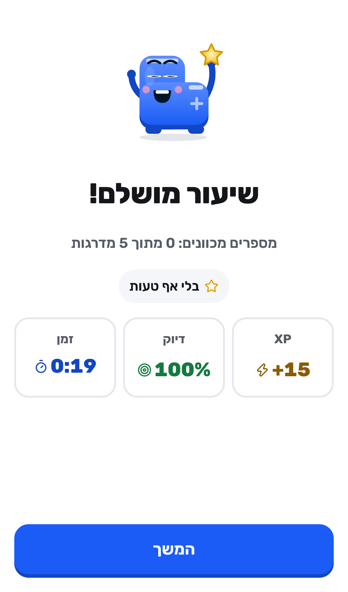 | 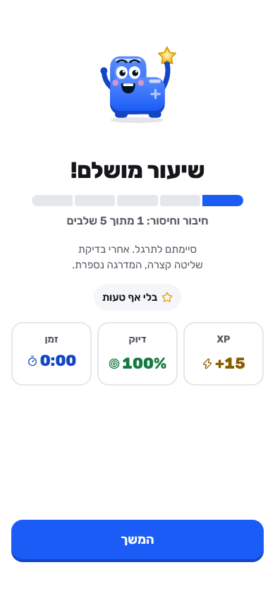 | "מספרים מכוונים: 0 מתוך 5 מדרגות" is now "חיבור וחיסור: 1 מתוך 5 שלבים" with five segments, plus what comes next ("אחרי בדיקת שליטה קצרה, המדרגה נספרת"), from integrity's counters |

Earlier stages' own before and after pictures are in `qa-evidence/student/`: `unit-identity-before/after.png`, `dark/`,
`madi/`, `streak/`, `class-goal/`, `visuals/`, `polish/`, `install/`, `push/`, `landing/` and `store/`.

---

## 6. Owner steps (one action each)

Nothing here can be done from code. Each step's code side is done and tested, and the step says where.

| # | Step | The one action | Where it is described |
|---|---|---|---|
| 1 | Confirm the product name and check trademarks | Search the Israel Patent Office's trademark database (classes 9 and 41) and both stores. If you rename, edit `APP_NAME` in `shared/brand.js` | `store/README.md` step 0 |
| 2 | Deploy the server with its address | Fill `PUBLIC_URL`, `CONTACT_EMAIL` and `BUSINESS_NAME` in `worker/wrangler.toml`, then run `deploy.ps1` | `README.md`, landing pages section |
| 3 | Turn the daily reminder on | `npm run push:keys`, then `npx wrangler secret put VAPID_PRIVATE_JWK`, then `VAPID_PUBLIC_KEY`, `VAPID_SUBJECT` and `PUSH = "on"` in `wrangler.toml`, and deploy (on Workers Paid, also `PUSH_BATCH = "400"`) | `README.md`, "התזכורת היומית" |
| 4 | Check the manifest's type on GitHub Pages | `curl -sI <pages-url>/manifest.webmanifest` once after the next publish | commit `ffe07e5` |
| 5 | Play Store | Account (personal: closed test, 12 adult testers for 14 days; or organisation with D-U-N-S), then `store/android/make.sh`, upload, asset links, Data safety, Israel only, paste the listing | `store/README.md` step 2, `store/android/README.md` |
| 6 | App Store | Enrol, then on a Mac run `IOS_BUNDLE_ID=… PUBLIC_URL=… bash madregot/store/ios/make.sh`, archive in Xcode, App Privacy, Israel only, paste the listing | `store/README.md` step 3, `store/ios/README.md` |
| 6a | Positioning | Read `docs/POSITIONING.md`, confirm the first market (teacher-led classes), add the direct link of the Vimi article, and re-check each rival's source before quoting it | `docs/POSITIONING.md` |
| 7 | Submission day | Re-read Apple 3.1.1, 3.1.3 and 5.1.2 and Play's Payments and AI-Generated Content policies | `store/README.md` step 4 |
| 8 | Lawyer | Review `store/privacy-answers.md` (DRAFT) and the privacy texts | `store/privacy-answers.md` |
| 9 | The real-device check | Section 4 of this file, about 20 minutes | above |
| 10 | The five-student test | Run it as written in `docs/student-test.md` and write `docs/student-test-results.md` | `docs/student-test.md` |
| 11 | The pilot | The teacher lane's pilot kit (TEACHER-10/13), then `npm run owner -- reach` for the numbers | teacher lane |

---

## 7. Deferred: what is not on this branch, and why

This branch (`lane-student`) started from `5618298`. Each item below is left out on purpose, never half built.

**Fixed in the review round (11 Nov 2026)**
- **Landing pages and listing say only what the code backs** (STUDENT-17, `web/src/content/claims.js`). Every sentence
  about a feature is a claim with a check that reads the code; the build prints the claims it showed and hid, and stops
  if one of the app's own claims (diagnosis, code grading, the teacher's board, Exam Rescue…) no longer holds. On this
  branch `/pilot/` no longer promises assignments with a due date, a printable class report, the pilot kit, deleting a
  class, the pilot report or the demo class, and `/mivchan/` no longer promises the weekly summary; each comes back by
  itself once its lane merges (its check names that lane's code). The store listing's teachers' line and the review
  notes (report an AI answer, the parent's OK) follow the same claims. `docs/POSITIONING.md` is the internal position.
- **The iPhone app's reminders are local notifications** (`web/src/lib/localReminder.js`): `pushState()` answers
  `store-ios` first in the `VITE_STORE=ios` build, so Settings never shows the Home Screen sentence there. Haptics play
  through Capacitor (`lib/native.js`). The Capacitor project is `store/ios/` (`make.sh`, pinned packages, privacy
  manifest); only the Mac and the account are the owner's.
- **Class-goal steps cannot be backdated**: a step counts on the day it is synced or the two days before, never in a
  week that has ended, and one student adds at most 60 points a week (on top of 30 a day). A phone offline for longer
  than that loses those steps for the class goal only (its own progress is untouched).
- **Store-app opens are counted** (`store_open_play`, `store_open_ios`), once a day a device.
- **First-load CSS is gated** (`studentCssDeltaKB: 0` in `web/budget.json`): 47.3 KB gzipped against 48.1 KB at
  `5618298`. Eighteen screens' own rules moved into `web/src/styles/lazy/`, loaded with each screen; a computed-style
  comparison of 15 screens in light and dark showed no difference. (On the integrated branch the lane's per-lane deltas
  over `5618298` gave way to DURABLE-11's gates in the same `budget.json`, which hold the whole merged first load; the
  `lazyOnly` rule stays, in the one `scripts/check-budget.mjs`. The class settings page, the class report and the class
  exam sheet open without the board, so they import `lazy/teacher.css` / `lazy/practiceExam.css` themselves.)

**Features that wait for another lane**
- **STUDENT-6, the Sunday recap.** It takes its numbers from PARENTS-1's `weekLocal` (`learn/report.ts`) so the child
  never sees two counts for one week, and shares through PARENTS-2's `ShareSheet`. Both are on the family lane (merged
  into the main branch at `a93644b`), not on this branch, and building the recap on its own copy of the week's
  arithmetic is what the spec forbids. Build it on the main branch right after this lane merges: `RecapCard` on Learn
  (Sunday to Tuesday, a non-empty last week, `nudges.recapWeek`), a lazy `RecapSheet`, `look.earnedAt` in
  `markEarned`, and the `recap_open` count. The week's Sunday recap test is a `test.skip` with this reason.
- **The iPhone install guide** (DURABLE-3's InstallSheet) is on the family lane. In iPhone Safari (not the App Store
  app) the install offer (STUDENT-10) shows nothing, and the reminder in Settings shows only the Home Screen sentence.
- **TEACHER-9's class settings page.** The teacher's "מטרת כיתה שבועית" block sits in its allowed temporary home, the
  "תלמידים" view of `Teacher.jsx`, until TEACHER-9 moves it. That page's class deletion must also delete `class_steps`
  and `class_goal_weeks`.
- **DURABLE-7's sync envelope.** The class-goal steps ride in the existing `/api/progress` body.
- **The pages' other-lane lines** (TEACHER-4/7/9/10/11/15, PARENTS-2, TRUST-4/9/11, AI-1/3, CURRICULUM-1) are claims
  that turn on at merge; after merging, run `npm run build` and `node madregot/store/make-listing.mjs` and read the
  printed claims (`claims.test.js` checks each lane's names with a stand-in of its code).
- **TRUST-1's `worker/datamap.json`** is not on this branch. At merge, add:
  - the client keys `<STORE_KEY>-theme` and `<STORE_KEY>-src`, and IndexedDB `madregot-push`;
  - the tables `class_steps`, `class_goal_weeks`, `push_subs` and `metrics_daily`;
  - then re-check `store/privacy-answers.md` against it.
- **Store submission** waits for TRUST-4 (report an AI answer, which Play's AI policy requires), TRUST-9 (the free
  parent OK) and TEACHER-1 (in-app teacher account deletion, Apple 5.1.1(v)).
- **TRUST-2's axe harness** is not on this branch. The contrast checks use this lane's `e2e/contrast.js`.
- **`web/e2e/fakeServer.js`** (trust lane) is not on this branch. `class-goal.spec.js` and `student-week.spec.js`
  carry their own `page.route` fakes.
- **The account export of the class-goal settings** belongs to the trust lane's export.

**Owner-side steps for the iPhone app**
- Building it needs a Mac with Xcode (`store/ios/README.md`). The privacy report (Organizer, Generate Privacy Report) and
  a TestFlight check of the reminder and haptics on a real iPhone are the owner's.
- `VITE_STORE_CLASS_AI=0` (class AI off in the iPhone build, if App Review objects to 3.1.3(c)) is not built: it would
  need the class AI gate that the trust lane's TRUST-11 owns.

**Library work left to task #76**
- **canvas-confetti** (M1, maths confetti) is not installed, so the existing Lottie confetti plays. If wanted, add the
  package `canvas-confetti` (1.9.3) in a separate change. It is already on `budget.json`'s `lazyOnly` list.
- Also left to task #76:
  - B2 (Drawer for Sheet) and M2 (ProgressRing, the parents' report);
  - Segmented on the other screens (GradeSwitch, Quests' daily goal, the advanced AI mode, Welcome, Rescue).
  - cmdk and Recharts stay off student routes.

**Budget and publishing**
- **The 260 KB boot JavaScript target** is DURABLE-11's (the per-topic content split, on the family lane). Here the boot
  JavaScript is 612.4 KB gzipped, 11.9 KB under `5618298`, and `chunkMaxKB` does not apply to the entry chunk until
  that split merges.
- **The 32 KB CSS total** is DURABLE-11's too; this lane's share (no net growth) is met and gated.
- **`publish-pages.sh`** (GitHub Pages) still runs a plain `vite build`, with no budget check. It was left alone to stay
  away from Pages.

**Owner-only (never done here):** deploys, real keys, the stores, a lawyer, the real-device check and the five-student
test (sections 4 and 6).

---

## 8. What the week showed that is still open

Running a whole week end to end showed three things that no single-feature test did. They are recorded here instead of
being changed in this proof stage.

1. **"שולטים לבד: 0" on Shabbat, two days after three passed mastery checks.** In `learn/mastery.ts`, a mastered stair
   becomes `needs-review` when its first spaced review is due. The profile counts only `mastered`, so on Shabbat it
   shows 0 next to "מדרגות שעליתם 3" and three "כדאי לחזור" chips
   ([after/T13-06-__me-full](qa-evidence/student/after/T13-06-__me-full.png)). The review is the integrity build's
   rule, and it is a good one. The wording, though, can read as progress lost, which is the council's #23.
   Suggestion: count `needs-review` together with `mastered` in that tile, and show "בדיקת זיכרון מחכה" beside it.
   This belongs to the integrity and Me screen owners.
2. **On Shabbat, the missions tab still offers the day's chest.** It says "עוד 3 משימות והתיבה נפתחת". There is no
   countdown and no pressure, and the streak rests. But a rest day could hide the daily chest, or say that it waits for
   Sunday ([week/phone/7](qa-evidence/student/week/phone/7-shabbat-streak.png)).
3. **The class-goal card waits up to 15 seconds before asking again** (`lib/classGoal.js` `FRESH_MS`). A student who
   finishes a step and opens the missions tab at once sees the earlier total until the app is reopened or comes back
   to the screen. With a real clock this almost never shows: a lesson takes minutes. The week's test moves its clock on
   after a step for that reason.
